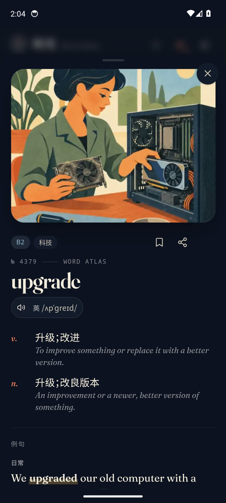
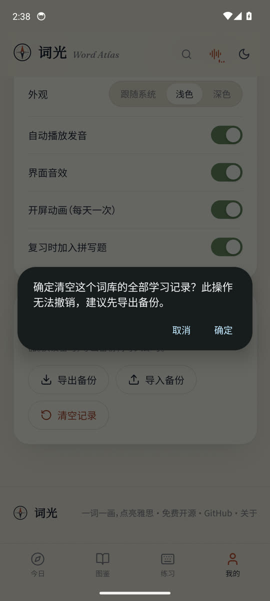
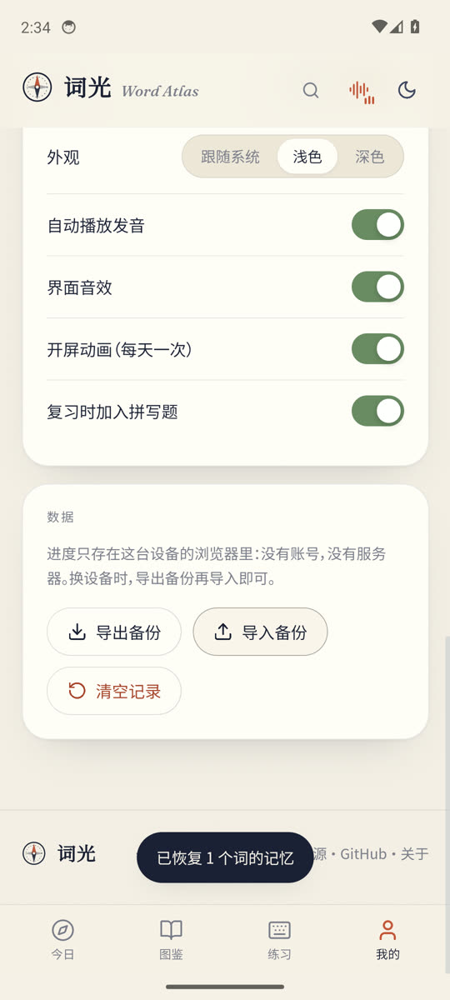

# 安卓离线版 / Offline Android build

> 仓库：[H1DDENADM1N/word-atlas-android](https://github.com/H1DDENADM1N/word-atlas-android)（上游原版：[designfuchen/word-atlas](https://github.com/designfuchen/word-atlas)）

把词光打包成一个**完全离线**的安卓应用：没有网络权限，不启动本地服务，不占端口，词库、插画、录音、音效、字体和语音合成引擎全部装在 APK 里。

<table>
<tr>
<td width="33%"></td>
<td width="33%"></td>
<td width="33%"></td>
</tr>
<tr><td align="center">今日</td><td align="center">图鉴</td><td align="center">词卡</td></tr>
</table>

<sub>截图来自 Android 14 模拟器（WebView 113）上安装的实际 APK。</sub>


## 三条硬保证

| 保证 | 做法 |
| :--- | :--- |
| **不能联网** | `AndroidManifest.xml` 里没有任何 `<uses-permission>`，包括 `INTERNET`。没有这个权限，系统内核拒绝为该 UID 创建 socket，代码层面无法绕过。另外还设了 `usesCleartextTraffic="false"` 与只允许系统证书的 Network Security Config。 |
| **没有端口 / 没有本地服务** | 不跑 HTTP 服务器，也不做请求拦截代理。页面直接用 `file:///android_asset/www/index.html` 打开，图片和录音同目录相对引用。整个应用不监听任何端口。 |
| **没有运行时下载** | 词库索引、73 个词条分片、24 段界面音效被内联进 `atlas-embed/data.js`；7,298 幅插画、7,298 张缩略图、22,905 段录音以文件形式放进 APK 的 `assets/www`。运行时没有任何 `fetch`。 |
| **不依赖系统 TTS** | 录音缺失时用 APK 内自带的开源语音引擎（sherpa-onnx + Kokoro-82M 音色）合成，不用 `TextToSpeech`、不用 `speechSynthesis`，也不需要用户在系统里装语音包。 |

同时也不含账号、埋点、统计或第三方 SDK。

## 体积

| 内容 | 大小 |
| :--- | ---: |
| 插画 `atlas/img`（512 px WebP） | 203 MB |
| 缩略图 `atlas/thumb` | 88 MB |
| 录音 `atlas/audio`（英音 / 美音 / 例句） | 426 MB |
| 词库 `atlas/entries` + `index.json` | 6.9 MB |
| 界面音效与配乐 `sfx` | 4.4 MB |
| 离线语音：ONNX Runtime + JNI（arm64 / x86_64） | 55 MB |
| 离线语音：Kokoro-82M 音色 + espeak 音素表 | 353 MB |
| 真题例句 `atlas/ielts.json` + 音节标注 `atlas/syllables.json` | 0.6 MB |
| 前端 bundle、字体、图标 | ~1 MB |
| **APK** | **约 1005 MB** |

安装需要约 2.5 GB 空闲空间。图片和音频本身已压缩，打进 APK 时按原样存储（不再二次压缩），所以构建很快；`.onnx` 也不压缩，运行时可以直接映射。

## 构建

需要 **JDK 17** 与 Android SDK（`platforms;android-34`、`build-tools;34.0.0`）。不需要 Gradle，也不需要 Android Studio。

```bash
# 一次性准备
sdkmanager "platforms;android-34" "build-tools;34.0.0"
export ANDROID_HOME=$HOME/.android-sdk   # 指向 SDK 根目录
export JAVA_HOME=/path/to/jdk-17

# 一次性拉取离线语音运行时与音色（约 540 MB，校验 SHA-256，不进仓库）
python3 scripts/android/fetch_tts.py

# 构建
python3 scripts/android/build_apk.py
```

产物是仓库根目录的 `word-atlas-offline.apk`。脚本会依次执行：`vite build`（相对路径 + 传统脚本）→ 生成内联数据 → `aapt2 compile/link` → `javac` → `d8` → 打包 assets 与 `lib/<abi>/*.so` → `zipalign` → `apksigner`。

只想复用已有的 `dist-android/` 时加 `--skip-web`。想减小体积可以只保留一种 ABI：

```bash
python3 scripts/android/fetch_tts.py --force --abis arm64-v8a   # 省 29 MB
```

首次构建会自动生成 `android/keystore/word-atlas.jks`（口令 `wordatlas`）。**这是自签名构建密钥**：想发布或长期升级，请换成自己的密钥并妥善保管——换密钥会导致已安装的旧版本无法覆盖升级。

安装：

```bash
adb install -r word-atlas-offline.apk
```

## 发版：版本号怎么改

版本号只有一个来源，就是 `package.json` 的 `version`：

| 位置 | 谁写 | 作用 |
| :--- | :--- | :--- |
| `package.json` / `package-lock.json` | 手改 | 唯一的版本来源 |
| 清单 `versionName` | `build_apk.py` 读 `package.json`，传给 `aapt2 link` | 系统「应用信息」里显示的版本 |
| 清单 `versionCode` | `build_apk.py` 的 `VERSION_CODE` | 覆盖升级的门槛，**每次发版 +1** |
| 「关于」页脚 | 原生桥 `version()` 从 `PackageManager` 读回 | 页面上那个 `v1.0.3` |

`versionCode` 忘了加：`adb install -r` 会失败（`INSTALL_FAILED_VERSION_DOWNGRADE`），或者装上去仍是旧版本——手机上看起来像"更新没生效"，实际是系统拒绝了同码或降码覆盖。版本名可以随意，code 必须单调递增。

当前对应关系：`1.0.3` → `VERSION_CODE = 4`。

## 与网页版的差异

网页版一行代码没少，离线版只在必要处做了替换，全部由构建配置和一层薄桥接控制，浏览器里打开仍然是原来的网站。

| 问题 | 处理 |
| :--- | :--- |
| `file://` 下浏览器禁止 ES module | 构建输出改成单个 IIFE bundle，并把 `<script>` 移到 `</body>` 前作为传统脚本；CSS 仍由 Vite 内联注入 |
| `file://` 下 `fetch()` 不可用 | 词库与音效内联进 `atlas-embed/data.js`，由 `src/atlas/embedded.ts` 读取；网页端没有 `__WA_DATA` 时自动回退到 `fetch` |
| Service Worker 无意义 | 检测到安卓壳时跳过注册 |
| 系统返回键 | `src/lib/native.ts` 把路由状态同步给原生层：先关词卡，再回上一页，最后才退出应用 |
| 分享卡片、备份文件 | 交给原生层写入系统「下载 / Word Atlas」目录（Android 10+ 走 MediaStore，无需存储权限） |
| WebView 没有语音合成引擎 | 原生层用 APK 内自带的 Kokoro 音色合成（见下一节），不用系统 `TextToSpeech`，也不需要用户在系统里装语音包 |
| 状态栏颜色 | 主题切换时通过桥接同步状态栏与导航栏配色 |
| `confirm()` / `alert()` 静默失效 | 设置 `WebChromeClient` 并实现 `onJsConfirm` / `onJsAlert` / `onJsPrompt`，改用系统对话框 |
| `<input type="file">` 点不开 | 同一个 `WebChromeClient` 实现 `onShowFileChooser`，拉起系统文件选择器，`onActivityResult` 回传 `Uri[]` |

WebView 侧还关闭了 `file` 域的脚本访问（`setAllowFileAccessFromFileURLs(false)`）与混合内容，并启用 `setBlockNetworkLoads(true)`。**内容访问必须保持开启**（`setAllowContentAccess(true)`）：系统选择器返回的是 `content://` URI，关掉之后页面就读不回用户选中的备份文件。

## 离线语音（内置 TTS）

7,298 个词的英音、美音、第一条例句都有真人录音（22,905 段）。但**第二条例句（雅思语境）只有 1,011 个词有录音**，其余 6,287 个词词卡上第二个喇叭以前是走系统 `TextToSpeech` 的——在没装英文语音包的机器上就是「点了没声音」。现在改为 APK 内自带的引擎。

第一版用的是 Piper `-low` 音色（16 kHz、小模型），实测明显发闷、机械感重。既然 APK 体积不是约束，就换成了 **Kokoro-82M**：同一套 sherpa-onnx 运行时，24 kHz 输出，一个模型内含 11 个英文音色（英式 `bf_emma`、美式 `af_heart`），自然度是这类小模型里最好的一档。

| 项目 | 选择 | 原因 |
| :--- | :--- | :--- |
| 推理运行时 | [sherpa-onnx](https://github.com/k2-fsa/sherpa-onnx) **1.13.8**（Apache-2.0） | 专为端上 TTS 设计，纯 C++/JNI，不需要 Gradle 或 NDK。锁 1.13.8 是因为 **2.0 起移除了内置 espeak**，而 Kokoro / Piper 都靠它做音素化 |
| 音色 | [Kokoro-82M](https://huggingface.co/hexgrad/Kokoro-82M) `kokoro-en-v0_19`（Apache-2.0） | 24 kHz，`model.onnx` 330 MB + `voices.bin` 5.5 MB；英式 / 美式只是同一个模型里换 speaker id |
| 不用 eSpeak NG | — | GPLv3 会传染整个应用，本仓库是 MIT |
| 不用系统 TTS | — | 那正是这次要去掉的依赖：不可控、可能联网下语音包、部分机型根本没有 |

同价位被否掉的方案：Piper `-low` / `-medium`（16–22 kHz，机器味重）、Matcha-TTS（更快但音质不如 Kokoro）、Kitten TTS（15M/80M，胜在体积不是音质）、XTTS / F5 / Chatterbox（参数量大一到两个数量级，手机上跑不动，且许可证多为非商用）。

实现分三层，都不需要 Kotlin 工具链：

| 文件 | 作用 |
| :--- | :--- |
| `android/app/src/main/java/com/k2fsa/sherpa/onnx/*.java` | 手写的 Java 镜像类。JNI 用 `GetFieldID` 按字段名读配置，所以包名、类名、字段类型必须和上游 `kotlin-api/Tts.kt` 逐字段对齐 |
| `TtsVoice.java` | 唯一暴露给应用的门面：`kokoro(...)` / `vits(...)` 两个工厂，`synthesize` 返回 PCM |
| `OfflineVoice.java` | 单线程合成 + `AudioTrack` 播放；负责把音素表解包到 `filesDir`、按口音选 speaker、`prepare()` 预渲染、单条音频缓存、`stop()` 打断、`onTrimMemory` 释放 |

几个实现细节：

- 模型直接读 `assets`（不复制，省 330 MB 空间）；**espeak 音素表必须落地成真实文件**（18 MB，首次使用解包一次），因为 espeak 内部用 `fopen` 读表。
- 只保留一个已加载的音色：模型常驻约 500 MB PSS，系统内存吃紧时 `onTrimMemory` 会主动释放，下次说话再加载。
- **预渲染**：慢的从来不是加载模型，而是合成——一句 20 个词的雅思例句要算 3 秒多。所以 `Speak` 组件一发现「这里没有录音」（`url == null`），就立刻把**这一句**送去合成，等用户真的按下喇叭时音频已经躺在内存里。缓存只保留最后一句（几百 KB），重听同一句是零等待。
- 预渲染和播放必须用**同一个速率**（`audio.ts` 里的 `VOICE_RATE`）：两边差 0.05 就会导致缓存键不匹配，白算一遍。
- 播放用 `AudioTrack` + `PCM_FLOAT` 分块写入，`stop()` 通过 token 作废当前任务，能立刻打断长句。

### 实测（Snapdragon 8 级真机，arm64）

| 场景 | 结果 |
| :--- | :--- |
| 模型加载 | 0.86–0.94 s（仅首次） |
| 合成速度 | **RTF 0.47**（7.8 秒语音算 3.6 s；短句 0.43–0.52） |
| 单个单词（约 0.6 s 音频） | 约 0.3 s 出声 |
| 例句**预渲染后**点按 | **0 ms 等待**，直接出声 |
| 例句**未**预渲染（打开页面立刻点） | 等 3.6 s 出声（7.8 s 的雅思长句） |
| 输出 | 24 kHz 单声道，峰值 0.68–0.92，无削波 |

同一份 APK 在 x86_64 模拟器上 RTF 是 2.6–3.4（模拟器没有 NEON，参考价值有限）。Kokoro 的输出电平比真人录音低约 6 dB，`OfflineVoice` 里乘了 1.8 倍增益拉齐，并夹在 ±0.98 以内防止削波；增益在渲染时只做一次，缓存里存的就是最终样本，重听不会叠加放大。

> 播放收尾也有坑：`AudioTrack` 只缓冲约 0.7 s，写完就 `release()` 会把最后一个词切掉（实测 7.82 s 的音频只播了 7.11 s）。现在用 `getPlaybackHeadPosition()` 等缓冲播完再释放。


## 学习界面：一屏之内

学习页是唯一一个「必须一屏看完」的界面——题干、四个选项和「继续」要同时在场，键盘弹起时输入区也不能被顶到看不见的地方。

原来的结构是「题干 `flex:1` + 选项 + 吸底反馈」：反馈用 `position:sticky; bottom:0` 贴住视口底边，作答后直接盖住后两个选项；图片题的插图 `min(100%, 300px)` 又把题干撑到 416 px，363×640 的机器上第四个选项落在首屏之外。真机实测（1272×2800 @560dpi，即 363×800 CSS px）：

| 场景 | 改前 | 改后 |
| :--- | :--- | :--- |
| 图片题（4 选项） | 文档高 887 px，需下滑 247 px | `scrollHeight == innerHeight` |
| 听音题 | 溢出 60 px | 0 |
| 作答后的反馈卡 | 覆盖选项区 146–482 px | 顶替选项，覆盖 0 |

现在的分层：

| 层 | 规则 | 作用 |
| :--- | :--- | :--- |
| `.learn` | 手机上 `height:100dvh; overflow:hidden`（结算页 `.summary` 除外） | 会话锁在一屏，页面本身不滚 |
| `.learn-stage` | `flex:1; min-height:0` | 允许子元素真正收缩，而不是把父级撑开 |
| `.prompt` | `flex:1; min-height:0; overflow:hidden` | 只吃剩下的高度，空间不够先压题干 |
| 插图 / 听音球 / 拼写配图 | `min(300px, 26dvh)` / `19dvh` / `15dvh` | 先缩图，不挤选项 |
| `.answer-zone` | `flex:none` | 选项与反馈共用同一个固定槽位 |
| 作答后 | `.answer-zone.is-answered .options { display: none }` | 反馈卡顶替选项，不叠加、不遮挡 |

桌面端不受影响：`.learn` 仍是 `min-height`，选项维持两列，反馈卡与选项并排。

`.summary` 必须排除在外——第一版把 `height:100dvh` 加在 `.learn` 上，结算页跟着被锁死，「完成」按钮永远点不到（真机上 swipe 也不动）。现在只有 `.learn:not(.summary)` 固定高度。

### v1.0.2：选项更高，词卡能动手

一屏装下之后，接下来修的是「够不够得着、点不点得动」。真机（363×800 CSS px）实测：

| | v1.0.1 | v1.0.2 |
| :--- | :--- | :--- |
| 选项高度（手机 / 桌面） | 54 px / 64 px | **68 px / 72 px** |
| 末个选项到屏底 | 8 px | **26 px** |
| 选项序号 | `<kbd>1–4</kbd>` | 去掉（数字键仍可选） |
| 作答后卡片 | 词头 + 释义 + 例句（手机端隐藏） | 词头（可点）+ 播放发音 / 播放例句 + 释义 + 例句 + 例句中文 |

几处实现：

| 位置 | 做法 | 为什么 |
| :--- | :--- | :--- |
| `.answer-zone` | `padding-bottom: calc(26px + env(safe-area-inset-bottom))` | WebView 未开 edge-to-edge 时 inset 为 0，26 px 是纯视觉留白；开了则自动再让出导航条 |
| `Feedback` 词头 | `<button class="feedback-word">` → `openWord(entry.id)` | 词卡浮在答题页之上，关掉回到原题，会话不中断 |
| `Feedback` 挂载 | `scrollIntoView({ block: "nearest" })` | 卡片比四个选项高，矮屏上「继续」会落在折线以下 |
| `src/lib/read.ts` | `play()` 被打断时返回 `"stopped"`，链条据此中断 | 单词→日常例句→雅思例句串起来读，切题或退出立刻掐断，不会在下一屏继续说话 |
| `EntryView` 的 `ExZh` | 模糊态放在组件 state 里 | 词卡关闭即卸载，再打开自然恢复模糊；不必额外记「已看过」 |
| `LookupText` | `word` 改成可选 | 填空句只有半句，没有词头要高亮；前后两半各渲染一个实例，靠 `word-atlas:lookup` 事件互斥 |
| `useKeys` | 有词卡打开时直接返回 | 否则空格/回车会隔着词卡把题目答掉或推进到下一题 |

### v1.0.3：词卡多了真题例句

把第三方《雅思真题例句词典》里的剑桥雅思 4 真题例句挂到词卡「雅思语境」下面。

| 位置 | 做法 | 为什么 |
| :--- | :--- | :--- |
| `scripts/atlas/import_ielts.py` | 遍历两个 MDict 容器里的 zlib 流：`.mdx` 的条目里只有 `<div class="ex-pl" data-id="C04T1L1_S04">` 占位符，句子本体在 `.mdd` 里那份 `data.js`（`var iaesd_data = […]`） | 没有实现 MDict 的键表/记录表索引——一次性的导入犯不上，而且不依赖词典的索引布局 |
| 词形校验 | 只收句子中真的出现该词的链接；屈折形式显式列举（`increase` → increased / increasing / increasingly），不是「词干 + 最多 3 个字母」 | 前缀规则会漏掉 e 脱落和 y→i：`increase` 加 `-ing` 是 `increasing`，前 8 个字母就不一样了，第一版因此丢掉 `increase` 14 条里的 8 条。词典的 `ex-match-der` 还会把 `visitor` 链到只讲 "a variety of shopping" 的句子，那类仍然要挡 |
| `public/atlas/ielts.json` | `pool`（句子本体）+ `words`（词条 → 句子 id） | 12,422 条链接只指向 1,211 句，逐词内联会把文件撑大好几倍；455 KB |
| `src/atlas/ielts.ts` | 第一次打开有例句的词卡时才加载，模块级缓存 | 不拖慢首屏。安卓侧由 `build_data_js()` 塞进 `__WA_DATA.ielts`，运行时同样没有 `fetch` |
| `EntryView` 的 `ExamExamples` | 一次显示一句，「换一句」翻页，出处做成胶囊标签（`C04T2L3`） | 卡片放不下十几句；出处跟着当前那句走，`title` 里给中文全称 |
| 朗读 | `<Speak url={null}>` | 真题例句没有录音，走 `shellSpeak` 的 Kokoro；`Speak` 挂载时已 `prepareVoice` 预渲染，按下即出声 |

一个词有几条就留几条（中位数 2 条、均值 5.6 条，`and` 顶到 403 条），按「含原词 > 句子更短 > 命题句」排序，`换一句` 逐条翻。

> 这一版第一稿每个词只留 4 条，而且「词干 + 最多 3 个字母」的前缀规则漏掉了 `increasing` —— `increase` 的 14 条只剩 4 条。改法是把屈折形式显式列举；随后发现 20 条的上限本身还是在偷偷丢句子（91 个词条超过 20 条，`study` 54、`language` 44、`crime` 22 都被截），于是**上限整个去掉**：`--per-word` 默认 0，等于「词典里有几条就是几条」。代价只有 44 KB（411 → 455 KB）。

覆盖 2,216 / 7,298 个词条（30%）。词典只收了剑桥雅思 4 的四个 Test，而词库里大量 A1 日常词（bedroom、pizza、elephant）本来就不出现在学术类文章里，所以这个比例是内容决定的，不是匹配漏了。

### v1.0.3：词头点一下看音节

OALDPEX 的词条自带音节标注，挂在词头元素的属性上，`oaldpex.js` 自己也是这么用的：

```html
<h1 class="headword" id="exhibition_h_1" syllable="ex·hib·ition" headword="exhibition">exhibition</h1>
```

```js
const syllable = $headword.attr("syllable");   // 点击时用 syllable 换掉 headword
```

| 位置 | 做法 | 为什么 |
| :--- | :--- | :--- |
| `scripts/atlas/import_syllables.py` | 还是遍历 zlib 流找 `<h1 … class="headword">`，取 `syllable` / `headword` 两个属性，要求去掉「·」后与词头一致 | 和 IELTS 那个导入器同一套取巧解析，不依赖 MDict 索引 |
| `public/atlas/syllables.json` | `{"dots": {词条 id: "ex·hib·ition"}}` | 4,672 条、109 KB；键用词条 id，省掉再对一次拼写 |
| `src/atlas/syllables.ts` | `useSyllables(id)`，模块级缓存，优先读 `__WA_DATA.syllables` | 与 `useIelts` 同构；安卓侧由 `build_data_js()` 内联，网页版才 `fetch` |
| `EntryView` 的词头 | `<h2>` 里套一个 `.hw-syl` 按钮，点一下在 `entry.w` 与带「·」的写法之间切换 | 词典本身就是「点词头切换」，这里照抄；没有标注的词条不渲染按钮，点下去也不会假装有反应 |
| `.hw-syl` | `font: inherit` + 去边框，**没有任何 transition**，也没有 `:active` 变暗 | 第一版给了 `transition: opacity .2s` 和 `:active { opacity: .6 }`，真机上点一下会先暗再回弹，看着像闪了一次。字距也不要跟着变：点一下只该多出几个点，整行不该跳 |

分隔点**不自己猜**。试过用同一批标注训一个切分模型（元音核 + 最大音节首 + `(辅音串, 右元音)` 众数），双音节词也只能复现 82% 的断点（`farm·ing` 会被切成 `far·ming`，`de·cline` 切成 `dec·line`），所以没有用它去补词典缺的那部分。

### v1.0.3：词卡上能点的地方变多了

原先只有例句里的英文能点开查词小窗，其余地方都是死文本。现在译文、常用搭配、词族、近义反义，以及释义里那半句英文也能点。

| 位置 | 做法 | 为什么 |
| :--- | :--- | :--- |
| `Lookup.tsx` | 把「一个打开中的小卡」抽成 `useLookup()`：点开时先派发 `word-atlas:lookup` 让别的实例关掉自己，再写入自己的 selection | 例句早就是这个规则，多出十几个入口后仍然只能有一张卡 |
| `LookupText` | 改用这个 hook，行为不变 | 顺带把「文本变了就关掉卡」的副作用并进去 |
| 新增 `LookupWord` | 单个词：`label` 是显示的写法（`librarian (n.)`），`token` 是真正去查的词（`librarian`） | 词族带词性后缀，直接拿整串去查会查不到 |
| 例句译文 / 真题译文 | `ExZh` 在**显示状态**下用 `LookupText` 渲染，模糊状态下仍是纯文本 | 模糊时点一下是「显示中文」，若同时把每个词变成按钮，两个点击语义会打架 |
| 常用搭配 | 英文与中文都过 `LookupText` | 中文里偶尔夹着英文（`public library` 的释义不会，但真题译文会） |
| 词族 / 近义 / 反义 | 换成 `LookupWord`，并沿用原来的虚线样式（`.relations .lookup-token`） | 词族原先点一下直接跳整张词卡；现在统一先弹小卡，卡片里仍有「查看词卡」 |
| 释义 | `senses` 里的 `s.en` 过 `LookupText`，并补一条 `.senses .en .lookup-token { font-style: italic }` | `.lookup-token` 是按钮，会把斜体拉正；释义英文本来就是斜体，得还回去 |
| 释义中文 | 保持纯文本 | 切词正则只认拉丁字母，查词索引也只有英文词头；中文在英文词典里没有可查的目标，做成按钮只会让人白点 |

译文里真的会出现英文：1,211 条真题译文中有 163 条夹着 `Oxford`、`University`、`these` 这类词，查不到的词会明说「这个词不在词光词库里」，不会静默失败。

### 排查记录：点开中文译文后整张词卡被撑宽

现象：`pit` 的第二条真题例句（`C04T4R1_S37`），点「点按显示」之后整张词卡横向变宽，右边被推出屏幕。

原因不在译文长度，在 `.lookup-glue`。`LookupText` 为了让「逗号不落到行首」，会把单词后面的标点一起包进一个 `white-space: nowrap` 的 span，判断用的是 `[^\sA-Za-z]`——这个类**也匹配汉字**。译文是「但在Fosbury的时代，锯末坑已经被……」：`Fosbury` 后面没有空格，于是从「的」到句末 30 多个字全被吞进那个 nowrap 片段，整段成了不可断的一行（544 px），而卡片内容宽只有 323 px。`.entry` 又是 `display: grid`，网格项默认 `min-width: auto`，于是轨道被内容撑开，整张卡跟着变宽。模糊状态下译文是纯文本，不经过切词，所以只有「点按显示」之后才会犯。

两处一起改：

| 位置 | 改法 | 为什么 |
| :--- | :--- | :--- |
| `Lookup.tsx` 的 `TRAILING` | `[^\sA-Za-z]+` → `[\p{P}]{1,4}` | 只有标点属于前一个词，汉字不属于；`\p{P}` 不会匹配 CJK 表意文字 |
| `.entry` | 补 `grid-template-columns: minmax(0, 1fr)` | 网格项的 `min-width: auto` 会让任何不可断片段撑宽轨道；`minmax(0, …)` 让它老老实实收缩 |

全库核对：866 个词条的真题译文里夹着拉丁字母（`Adelaide待了1年`、`biomechanics（生物力学）`、`Rembrandt的奇妙画作`），改前它们都会把整句粘成一行。改后浏览器实测 10 个词条、每条最多 6 句，`.entry` 的 `scrollWidth` 全部等于 `clientWidth`；英文标点仍然粘连（`Traditionally,`、`sawdust.`、`tree.`）。

覆盖 4,672 / 7,298 个词条（64%）。缺的 2,626 个里 1,694 个是单音节（本来就没有可断的地方），剩下 932 个是词典自己没标的多音节词（`hotel`、`river`、`city`、`study`），点词头不会有变化——这一条在「关于」里写明了，不装作能用。

### 排查记录：真机上点屏幕弹不出键盘

现象：打字练习进去后点文字区域毫无反应，输入法不弹；而从「搜索」进去的输入框是正常的。

原因不在键盘，在焦点：`TypingRound` 与 `SpellInput` 都用**透明 `<input>`** 接管输入（`position:absolute; opacity:0`），并带 `autoFocus`。它一挂载就已经是 `document.activeElement`，用户点屏幕时执行的 `input.focus()` 因此是一次空操作——没有 `focus` 事件，WebView 也就不会请求输入法。搜索结果框是首次聚焦，所以正常。

三处一起改：

1. `src/lib/keyboard.ts` 的 `focusField()`：已经聚焦时先 `blur()` 再 `focus()`，制造一次真实的焦点变化；随后 `revealField()` 在键盘动画结束后把输入区滚进可视范围。
2. 原生桥接补 `showKeyboard()` / `hideKeyboard()`（`InputMethodManager`），让唤起输入法不再依赖上面那个时序技巧；网页版没有桥接时自动退回纯 JS 路径。
3. `viewport` 加 `interactive-widget=resizes-content`。WebView 本来就有 `adjustResize`，布局视口会跟着键盘缩小；补这一条是让浏览器版行为一致。

`adjustResize` + `100dvh` 意味着键盘弹起时整个会话页按新高度重排：拼写步骤在 352 px 高的视口里仍能同时放下配图、题干、字母格和两个按钮。

> 顺带把打字练习页在手机上改成全屏 fixed 覆盖层（`.practice.typing`）。它原先待在 tabbar 与 footer 之间，键盘一弹页面就滚，目标词正好落在键盘后面。


## 排查记录：导入备份 / 清空记录「无效」

真机上这两个按钮看起来毫无反应，根因不在业务代码，而在壳层漏配了 `WebChromeClient`：

| 操作 | 页面里的实现 | 没配 `WebChromeClient` 时 |
| :--- | :--- | :--- |
| 清空记录 | `if (!confirm(...)) return` | `confirm()` 直接返回 `false`，函数在第一行就退出了，**看起来像没反应** |
| 导入备份 | `<input type="file">` | 不触发任何选择器，点击无任何反馈 |

补上 `ShellChrome extends WebChromeClient` 之后两者都恢复。修完后在模拟器上做了端到端验证（见下节「已验证」最后两条）。

 

## 排查记录：分享卡片「生成失败，请稍后再试」

网页版正常，装进 APK 后**每个词都失败**。关键线索是那句 toast：`saveFile` 失败会走原生自己的「保存失败：…」，而这里报的是 JS 的「卡片生成失败」，说明异常发生在**保存之前**——也就是 `canvas.toBlob()`。

根因是 **canvas 被污染（taint）**：

| 环节 | 网页版 | APK |
| :--- | :--- | :--- |
| 页面来源 | `https://…` | `file:///android_asset/www/index.html` |
| 插图来源 | 同源 http | 同源 `file://`，但每个 file 文档是独立的不透明源 |
| `drawImage(插图)` | canvas 干净 | canvas 被标记为污染 |
| `canvas.toBlob()` | 正常出 PNG | 回调收到 `null` → 抛错 → 失败 toast |

按规范 `toDataURL()` 会直接抛 `SecurityError`，`toBlob()` 则是回调给 `null`，两条路都通向同一个 toast，所以现象是「每次都失败」。

两种修法：

- **放宽 `setAllowFileAccessFromFileURLs(true)`**：能让 file 文档互相视为同源，但等于让页面 JS 能读任意 file:// 资源，和本项目的隔离基调不符，而且不同 WebView 版本行为不完全一致。
- **把插图换成 `data:` URL**（采用）：`data:` 图片永远是 origin-clean，canvas 不会被污染。新增桥方法 `assetDataUrl(url)`，把 `file:///android_asset/...` 读成 base64 `data:` URL 交给页面——字节和页面显示的是同一份，视觉完全一致。

```ts
// src/ui/share.ts
async function illustration(src: string | null) {
  if (!src) return null;
  const inline = assetDataUrl(src);          // APK 内：data: URL
  return inline ? loadImage(inline) : loadImage(src);   // 网页：原样
}
```

桥方法只允许读 `assets/www/` 之下的路径，避免变成一个任意文件读取口。修完实测：`upgrade` 词卡生成 1080×1440 PNG，插图、音标、释义、例句、页脚齐全，落在 `下载/Word Atlas/`。

顺带修掉同一批日志里的 `Uncaught (in promise) AbortError: Transition was skipped`——`startViewTransition()` 的 `ready` 在新转场打断旧转场时会 reject，之前只 catch 了 `finished`。快速连点导航时每次都会刷一条，现在 `ready` / `finished` 都吞掉了。

## 分享：保存后拉起系统弹窗

三张卡片（词卡 / 星图 / 成绩卡）都是「先存到下载目录，再弹系统分享面板」，微信、邮件、抖音都在面板里。WebView 不支持 `navigator.share({files})`，所以这一跳必须由原生完成。

用 `ACTION_SEND` + `Intent.createChooser` 时有两个必须踩过才知道的坑：

| 坑 | 现象 | 解法 |
| :--- | :--- | :--- |
| `file://` 不能交给别的 app | API 24+ 直接 `FileUriExposedException` | 换成 `content://` |
| 本项目没有 AndroidX | 用不了 `FileProvider` | 自带 `ShareProvider`：只读 `cacheDir/share`、`exported="false"`、靠一次性 grant 放行 |
| chooser 里嵌套的 intent **不继承** URI 授权 | 接收方 `SecurityException: not exported from UID`，预览缩略图也裂开 | 目标 intent 和 chooser 都要 `setClipData(...)` + `FLAG_GRANT_READ_URI_PERMISSION` |

`ShareProvider` 只认 `cacheDir/share/<文件名>`，并对 `..` 和路径分隔符做了拒绝，不会变成任意文件读取口。临时文件按 24 小时清理。

这一跳之后仍然**没有任何权限声明**（`aapt2 dump permissions` 只输出包名），也不需要 `WRITE_EXTERNAL_STORAGE`。

## 自测

不需要真机也能先验证网页层：把 `dist-android/`、`android/build/data.js`、`public/atlas`、`public/sfx`、`public/brand` 放进同一个目录，用浏览器打开 `index.html`（`file://`）。页面能正常显示图鉴、词卡、发音，就说明数据内联与相对路径都对了。

真机上建议确认：首屏、图鉴网格、词卡翻页、英美发音、星图（WebGL2）、返回键、分享卡片保存位置、深浅色切换、导出 / 导入备份、清空记录，以及**没有录音的那条例句的朗读**。

学习页的「一屏」可以先在桌面上量，不必每次都装包：用 Playwright 按设备视口（363×640、360×600、363×800）跑完一整轮，比较 `document.documentElement.scrollHeight` 与 `innerHeight`，再判断反馈卡与选项区的矩形是否相交。键盘态直接把视口高度改成 55%（相当于 `adjustResize` 之后的高度）重量一次，就能看出输入区会不会被顶出去。

语音可以脚本化验证。用调试开关启动应用，就能通过 Chrome DevTools 直接驱动页面：

```bash
adb shell am start -n tech.wordatlas.app/.MainActivity --ez wa.debug true
adb forward tcp:9222 localabstract:webview_devtools_remote_$(adb shell pidof tech.wordatlas.app)
node scripts/android/verify_speech.mjs budget
```

脚本会用两种口音各合成一句、再打开 `budget` 词卡点第二个喇叭，`adb logcat -s WordAtlasVoice` 里能看到采样数、耗时与峰值电平。

## 已验证

在 Android 14（API 34）模拟器上安装实际 APK 后逐项确认：

- 安装、启动、开屏动画、引导页、今日页、图鉴（网格 / 列表）、词卡、星图（WebGL2）均正常渲染；
- 系统返回键先关词卡、再回上一页，不会直接退出应用；
- 深浅色切换时状态栏与导航栏同步变色（原生桥接）；
- **强制停止后重新打开，主题与学习进度仍在**——`file://` 源下的 `localStorage` 在 WebView 中可用；
- **导出备份**：文件落在 `/sdcard/Download/Word Atlas/word-atlas-backup-YYYY-MM-DD.json`，走 MediaStore，无需存储权限；
- **导入备份**：点击后拉起系统文件选择器，选中备份即回到应用并提示「已恢复 N 个词的记忆」。用一份手工注入 1 张卡片的备份实测，图鉴从 0 变成「1 / 7,298 颗星已点亮」，「我的」页显示已点亮 1 / 长期记住 1，未来 7 天复习量「今天 1」；**强制停止再打开，这 1 个词仍在**；
- **清空记录**：弹出系统确认框，点「确定」后提示「学习记录已清空」，复习曲线归零；**强制停止再打开仍为 0**；
- **内置语音**（真机 arm64）：打开 `upgrade` 词卡（第二条例句无录音），**还没点任何按钮**，日志里已经有 `loaded kokoro in 842 ms` 和 `rendered 187,593 samples (7.82 s) in 3632 ms · rtf 0.46`；随后点第二个喇叭 → `spoke 187,593 samples (7.82 s) in 7799 ms`，**没有新的渲染日志**（说明命中预渲染缓存，点按零等待），播放时长与音频长度一致（尾巴没被切）；再点一次 → 3.20 s 处 `stopped early`，能打断且不崩溃；页面里 `typeof window.speechSynthesis === "undefined"`，确认完全没有走系统语音；
- 导出两段样音核对音质：en-GB 3.60 s（峰值 0.903 / RMS 0.117）、en-US 2.96 s（峰值 0.715 / RMS 0.104），24 kHz 单声道，非静音；
- **分享卡片**：点词卡右上角生成 1080×1440 PNG，落到 `下载/Word Atlas/`，随后自动弹出系统面板（标题 `Share 1 image`、预览缩略图正常、列表里有微信 / 邮件 / 抖音）；`logcat` 里 `Permission Denial` 与 `FileUriExposed` 计数为 0，返回键关掉面板后应用原样恢复；
- `zipalign -c` 校验通过，`apksigner verify` 通过，`aapt2 dump` 确认无任何权限声明。

手机学习界面的复验（Android 16，OnePlus PLR110，1272×2800 @560dpi，即 363×800 CSS px）：

- 图片题、听音题、词义题四种形态下，四个选项与「继续」全部落在首屏，页面不滚；
- 作答后反馈卡出现在选项原来的位置，不再压住任何选项；
- 拼写步骤在键盘弹起后仍同时显示配图、题干、字母格与「提示字母 / 确认」；
- 打字练习进入即自动唤起输入法（`dumpsys input_method` 的 `mInputShown=true`），目标词与中文释义都在键盘上方，连续输入 10 项不掉焦点；
- 结算页可正常下滑到「完成」，此前被 `100dvh` 锁死的问题已修复。

> 小坑：用 `adb push` 覆盖「下载」里的备份后，文件管理器会显示「无内容」——`adb push` 不会通知 MediaStore。补一条 `am broadcast -a android.intent.action.MEDIA_SCANNER_SCAN_FILE` 即可，正常用户通过系统导出 / 复制文件不会遇到。

另外用 Chromium 以 `file://` 打开同一份产物做了交叉验证：12 个图块、词卡插图、例句、录音（`duration` 可读出）全部正常，无失败请求。

> 模拟器上的 WebView 是 113 版，比桌面 Chromium 旧。图鉴网格最初因 `<button>` 内的弹性子元素没有拿到宽度而空白，已通过给 `.tile .illo` 显式设宽修复——这类问题只有在真机 / 旧内核上才会暴露。

## 已知限制

- **冷启动**比网页版慢一点：首次要从 APK 里读取内联数据并解析。
- **APK 很大**：1005 MB 是「全部资源装进 APK」的直接代价，其中 353 MB 是 Kokoro 音色。想瘦身可以只保留 `thumb/`（省 203 MB）、把录音转成更低码率、只打一个 ABI，或者换回 Piper 音色（`fetch_tts.py --voice piper`，省约 290 MB，音质明显下降）。
- **内置语音的延迟**：模型加载约 0.9 s，合成一句 7.8 s 的雅思长句要 3.6 s。点按之所以感觉即时，是因为按钮一出现就预渲染了；如果页面刚打开就立刻点，仍要等那 3.6 s。模型常驻约 500 MB PSS，系统内存吃紧会自动释放，下次说话再加载。
- 语音只是兜底：22,905 段真人录音优先，TTS 只补第二条例句缺失的那 6,287 个词。
- 内容仍是开源版的 7,298 词，许可与网页版一致（代码 MIT，词库与插画录音 CC BY 4.0，Kokoro-82M Apache-2.0，sherpa-onnx Apache-2.0）。
